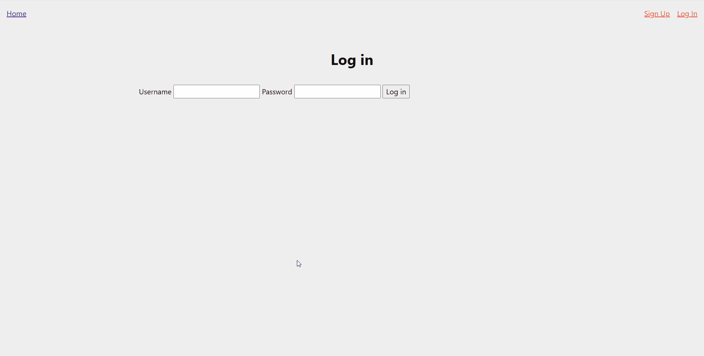
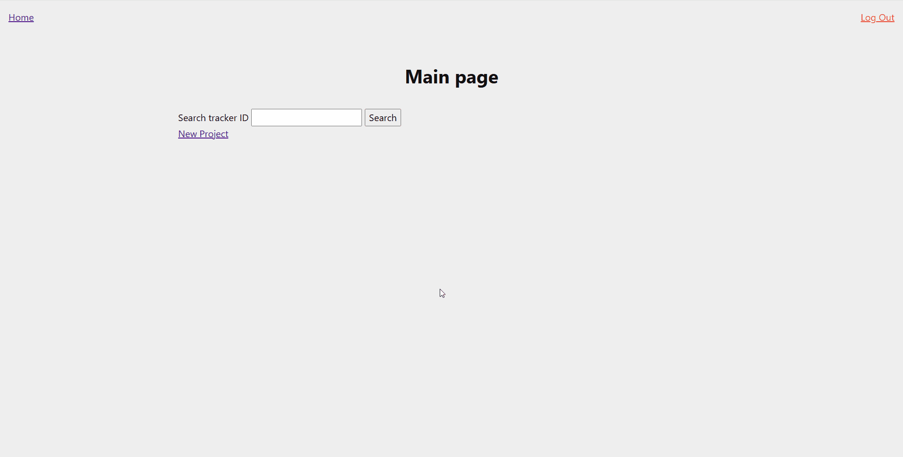
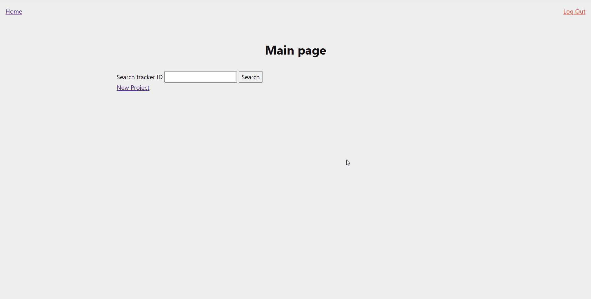

# Sprint 2 - Implement Database and Display of Test Data

## Sprint Goals

Implement the database, populated with test data. Create queries that retrieve test data, and display this on web pages as needed. Test and refine the queries and data display, so that it stands as the basis of the next sprint.

### Specific Goals

**Edit these goals as needed**

- Implement the database
- Add test data to the database
- Create the following web pages:
    - Home page that can search projects
    - Sign up/log in pages
    - Project creation pages
    - Project viewing pages
- Develop SQL database queries to:
    - Retrieve and compare a password hash to log in
    - Retrieve a project with an ID to display
    - Retrieve all milestones attached to a project

## Testing sign up

I am testing the page that creates new accounts, it should only accept the input when both field are empty and the username is unique.

### Changes / Improvements

None required.

## Testing log in

Log in Just needs to make sure both fields are filled and the password matches.

### Changes / Improvements

None required.

## Testing create and display project

You should be able to create a project with a name, description, and milestones, and you should then be able to search it's ID to view it.

There seems to be something wrong with the status flag, this means that all of the milestones are shown as incomplete.

### Changes / Improvements

The problem was, the values the checkbox where returning weren't compatible with a boolean, so I had to add a line to make it compatible, anyway, it works now!

## Sprint Review

This sprint went by fairly smoothly, I managed to make functions that covered all of the things I required of my database.