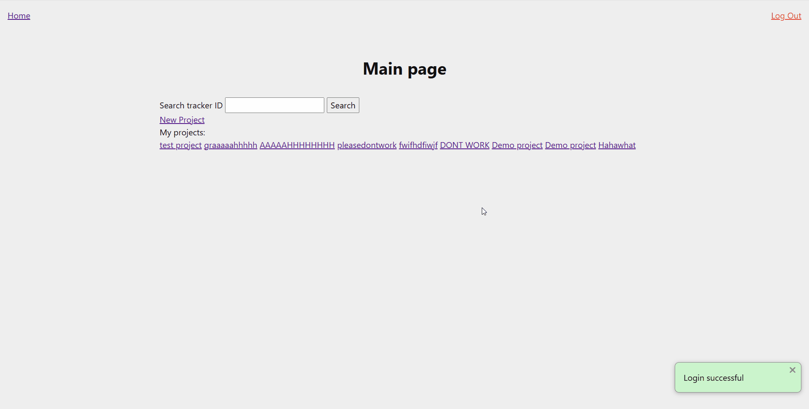
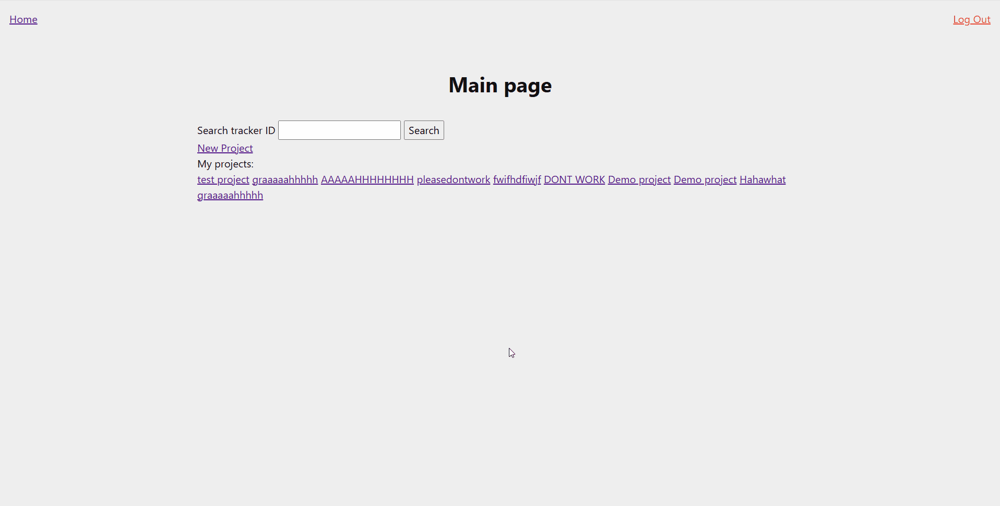
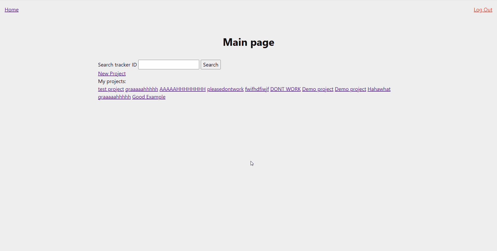
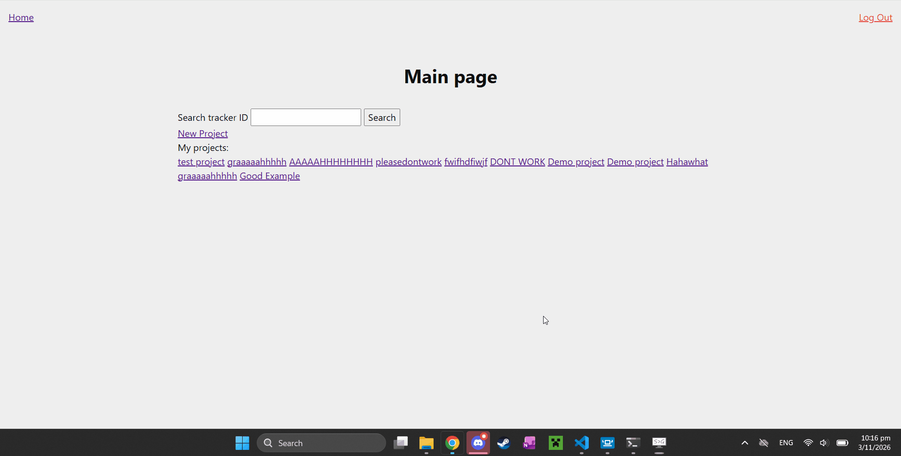
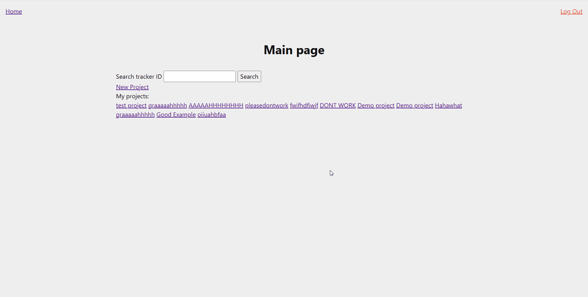

# Sprint 3 - Developing a Minimum Viable Product (MVP)

## Sprint Goals

Continue to develop the web application to the point that it provides all key functionality of the system. Test and refine it so that it can serve as the basis for the final phase of development.

### Specific Goals

**Edit these goals as needed**

- Create the following web pages:
    - Form to edit projects
- Develop SQL database queries to:
    - List projects created by you on the home page
    - Edit pre-existing data
    - Delete an unneeded project

## Displaying projects you created

When you're logged in, the system works fine, there are links to all the projects and they all operate as intended, the problem is when you're logged out, the site crashes.

### Changes / Improvements

This happens because to get the projects that the user has created, the site tries to check if the user is logged in, but when the user is logged out, the variable that states this doesn't exist, resulting in the crash.

## Editing a project

The edit function as shown here works fine, but I forgot to put the pre-existing description for editing.

### Changes / Improvements

This is how it should be.

## Deleting a project

Unfortunately my delete function does not seem to be working at the moment.

### Changes / Improvements

The problem was that I forgot to execute the sql after writing it, and also was missing a comma, but now that both of those are in place, my delete function works!

## Sprint Review

Finishing this sprint means my website is now fully functional, and I've made the user experience as smooth as I've had time for.

