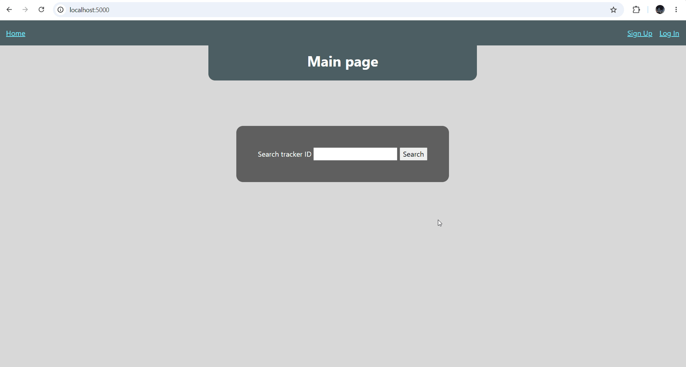
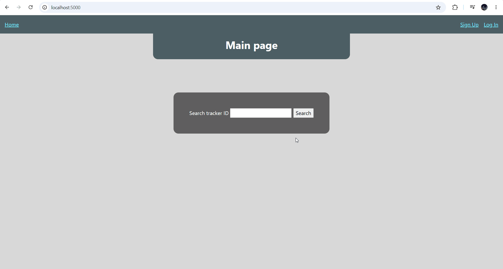
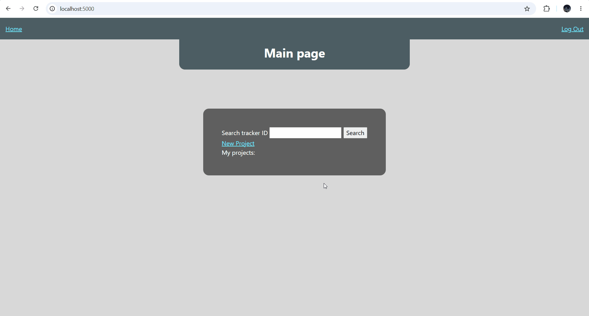
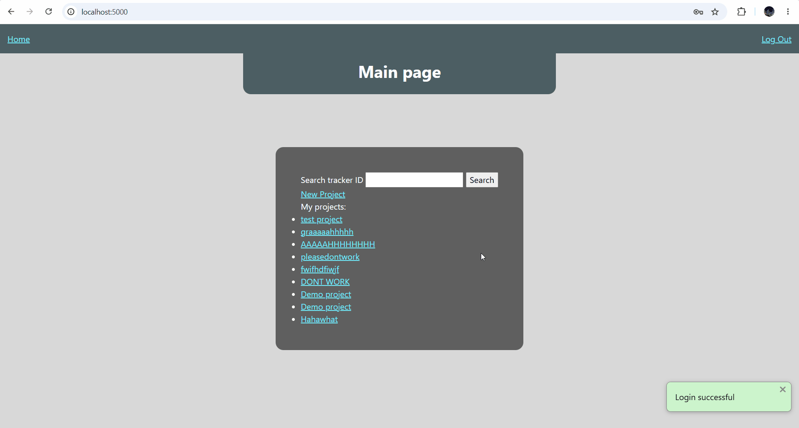
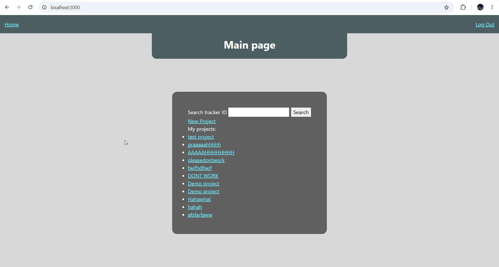

# Sprint 4 - Developing a Refined and Complete System

## Sprint Goals

Develop the system until it is fully featured, with a refined UI and it satisfies the requirements. The system will be fully tested at this point.

### Specific Goals

**Edit these goals as needed**

- Refine the design and UI of the website
- Refine the user experience (UX) of the system
- Perform final, full-system testing

## Adding colours

To make my site more visually appealing I added a blue/grey colour palette.

### Changes / Improvements

A lot of the contrast was bad, and also the main text wasn't coloured, so I fixed that.

## Formatting

To continue making my site more readable, I added padding and moved around different assets on my pages

### Changes / Improvements

None

## Testing unauthorized  access

There are some pages on my website that should only be accessed when you are logged in to the right account, but at the moment you can bypass tis by typing the url of the page into the search bar, as shown in the GIF below.

### Changes / Improvements

Added functions to check if A: You're logged in. B: If applicable, your account owns the project you're trying to edit/delete. 

## Testing entering add milestone page for a project that doesn't exist.

The add milestone page is intended to come directly after the create project page, so when it doesn't it causes issues

### Changes / Improvements

I just needed to add a simple check and now it simply redirects to project creation.

## Sprint Review

With this sprint done my project is finally complete,my website now has css, and is as far as I can tell, bug free.

